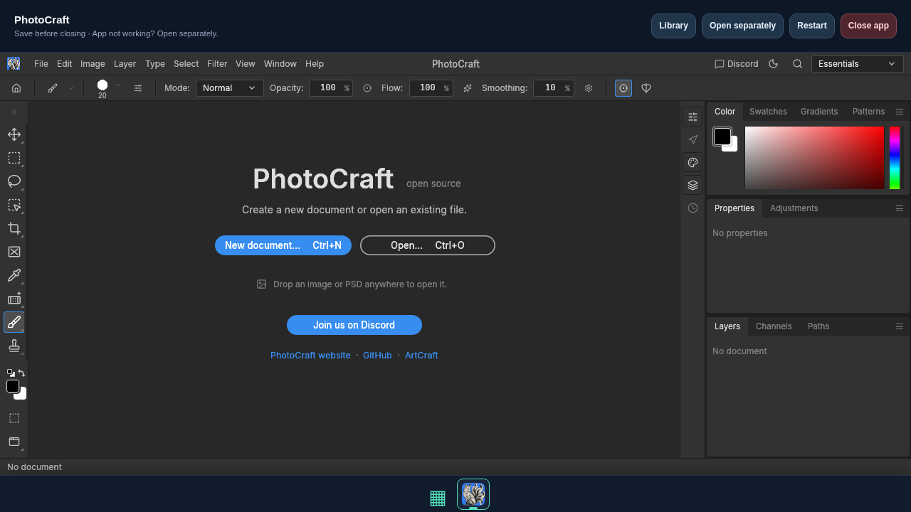

# Implementation and acceptance evidence — 2026-10-15

Scope: CODEX_TASK.md productionization, using separate authentication/security,
updater, frontend, packaging, browser integration and independent review agents.
The existing MVP was retained and improved. No model-picker state was changed or
claimed. This report distinguishes tested behavior from configured or blocked work.

## Executed results

| Check | Result |
| --- | --- |
| `CRAFT_VENV_DIR=/workspace/venvs/craft-portal bash .codex/setup.sh` | 64 passed, 4 browser tests explicitly skipped; Python compile and both JavaScript syntax checks passed |
| `CRAFT_BROWSER_TESTS=1 PLAYWRIGHT_BROWSERS_PATH=/workspace/cache/ms-playwright python -m pytest tests/browser -q` | 2 Chromium tests passed; 2 Firefox tests skipped because executable download was blocked |
| Chromium single-user integration | Setup, login/logout, CSRF, actual minimal WASM instantiateStreaming, separate app origin, rollback, offline/reconnect, reconstructed application/database restart, keyboard/modal, installer platform filtering, polling503/retry preserving unsaved settings |
| Chromium multi-user HTTPS integration | Two accounts in the same browser profile, separate app origins, localStorage and OPFS separation, unauthorized/cross-host copied-cookie rejection |
| Download/update regressions | Required digest, size/truncation/digest failures preserve active version, normal ZIP directories accepted, malicious paths/links/file collisions rejected, retention after rollback, serialized mutation, immediate then six-hour background checks |
| Backup/recovery regressions | WAL-safe SQLite backup, file checksums, corruption/link rejection, no overwrite, restored login and retained app launch, old sessions revoked |
| Native Docker build/runtime | AMD64 build; UID10001, read-only root, dropped capabilities, no-new-privileges, writable private data volume, health, SQLite and restart persistence |
| `docker compose config --quiet` | Passed |
| nginx HTTPS example | `nginx -t` passed in nginx:1.28-alpine with temporary test certificate |
| Independent implementation review | No concrete code blockers reported; service-worker local-cache and deployment boundaries recorded in SECURITY_REVIEW.md |
| Live official-release verifier | Failed before discovery; report contains zero verified apps and URLError; direct catalog/API checks show CONNECT403 from managed egress proxy |

One Starlette/AnyIO deprecation warning is emitted by TestClient; tests execute
and pass. It is not a test failure. Browser tests are opt-in locally; CI sets
`CRAFT_REQUIRE_BROWSERS=1` so missing engines/dependencies fail instead of skip.
Test certificates and synthetic app files never represent real upstream acceptance.

## Hosted release validation

The [v0.1.0-rc.1 workflow](https://github.com/Timminater/craft-portal/actions/runs/38722248221)
completed successfully on 2026-10-15: unit tests, strict Chromium/Firefox browser
job, AMD64/ARM64 image builds, native hardened-container checks, GHCR publishing
and GitHub prerelease creation all passed. This supersedes the earlier local-only
Firefox/build/hosted-publication limitations below. It does not establish native
ARM64 runtime or real ArtCraft browser compatibility.

The public registry manifest was independently inspected and contains linux/amd64
and linux/arm64. The published image was anonymously pulled and booted with the
exact Unraid template security flags: first-run API, separate app origin, UID10001
and persistent SQLite passed (named-volume surrogate; no actual Unraid host tested). The release's image index digest is
`sha256:e37b88270937e506513d374e8ccac878e4292c7b3fa5ee8a14b3633e6b048b53`.
The initial metadata action also produced a latest alias for this prerelease;
install the explicit `v0.1.0-rc.1` tag. Future automatic latest tagging is disabled.
The Unraid user template and installation guide are available on main under
`unraid/` and `docs/unraid.md` (added after the immutable release tag).

## Reproduce

From the checkout, use Python3.12 and Node for syntax checks:

```sh
bash .codex/setup.sh
. .venv/bin/activate
python -m pip install -r requirements-browser.txt
python -m playwright install --with-deps chromium firefox
CRAFT_BROWSER_TESTS=1 CRAFT_REQUIRE_BROWSERS=1 python -m pytest tests/browser -q
python scripts/verify_official_releases.py --run-live --report /tmp/craft-releases.json
docker compose config --quiet
docker build -t craft-portal:test .
```

The live verifier downloads every catalog app into temporary storage, checks
publisher and digest, then requests authenticated HTML/JS/WASM and records MIME,
COOP/COEP and service-worker filenames. It does not execute those real apps in a
browser. Real-app browser/WebGPU/service-worker acceptance remains required.

Managed cloud builds need the session proxy and CA mounted during pip installation;
use the saved environment startup instructions or retained cloud build helper.
Local Linux developers with normal trusted Internet do not need this adaptation.
Never disable TLS/checksum verification. Browser TLS isolation binds443; use a
free local port443 and the documented test-only permissions on a CI runner.

## Blocked / not executed

1. **Official releases:** managed network rejects getartcraft.com and api.github.com.
   Required allowed domains were saved in the environment draft, including official
   release redirect hosts. Review/save the environment settings to apply them;
   retry discovery and verify every genuine ZIP and app in both browsers.
2. **Firefox:** official Playwright CDN returned403 Domain forbidden. Browser
   distribution hosts were added to that same draft. Install the pinned browser
   after network access is applied and run strict browser acceptance.
3. **ARM64:** no qemu-aarch64-static/binfmt support; Buildx advertises only amd64.
   CI uses QEMU for multiarch builds. A native ARM64 deployment test remains needed.
4. **Hosted actions / images:** workflows were written and YAML parsed, but hosted
   CI and GHCR publishing were not observed. Tagged release reuses the complete CI
   gate before publishing version/commit tags with SBOM and provenance. Do not tag
   a production release before the real-app gates pass.
5. **Deployment:** real public DNS/TLS, Unraid ownership and operational restore
   must be validated on the target host. The supplied example and local checks do
   not establish those external deployment properties.

## Delivery review

See SECURITY_REVIEW.md for controls/residual risks, KNOWN_LIMITATIONS.md for release
gates, browser-testing.md for test fixtures, and deployment/README.md for HTTPS,
Unraid, GHCR and backup/restore. No production-ready claim is made while the
blocked acceptance work remains outstanding.

## PhotoCraft real-release browser check (2026-10-15)

Official archive:
`https://github.com/storytold/photocraft/releases/download/v0.9.0/photocraft-web-0.9.0.zip`.
Downloaded size: 11,467,035 bytes. SHA-256 matched the publisher digest shown
on GitHub's expanded release assets:
`b3fa5ab6a9d32bc5ff7dfdde31939a2337471a196a2e70f1ff961a61b1bb02e6`.
The normal bounded archive unpacker installed the archive under a versioned path.
A local HTTPS shared-host portal with a synthetic account opened the full editor
inside the dock workspace and separately. JS/WASM returned 200 with correct MIME;
no JS exceptions or failed requests occurred. The optional upstream
`fonts/manifest.txt` is missing in the ZIP (404), without preventing editor startup.
Headless rendering used the software GPU fallback. No production login was used.



This verifies startup of one real version in Chromium, not editing/export features,
all apps, Firefox real-app support or the operator's DNS/proxy/TLS deployment.
The live portal request is denied by the managed cloud proxy before navigation.
The reported operator error `SSL_ERROR_UNRECOGNIZED_NAME_ALERT` occurs at TLS/SNI
negotiation before the portal serves the app. See workspace.md for resolution.
