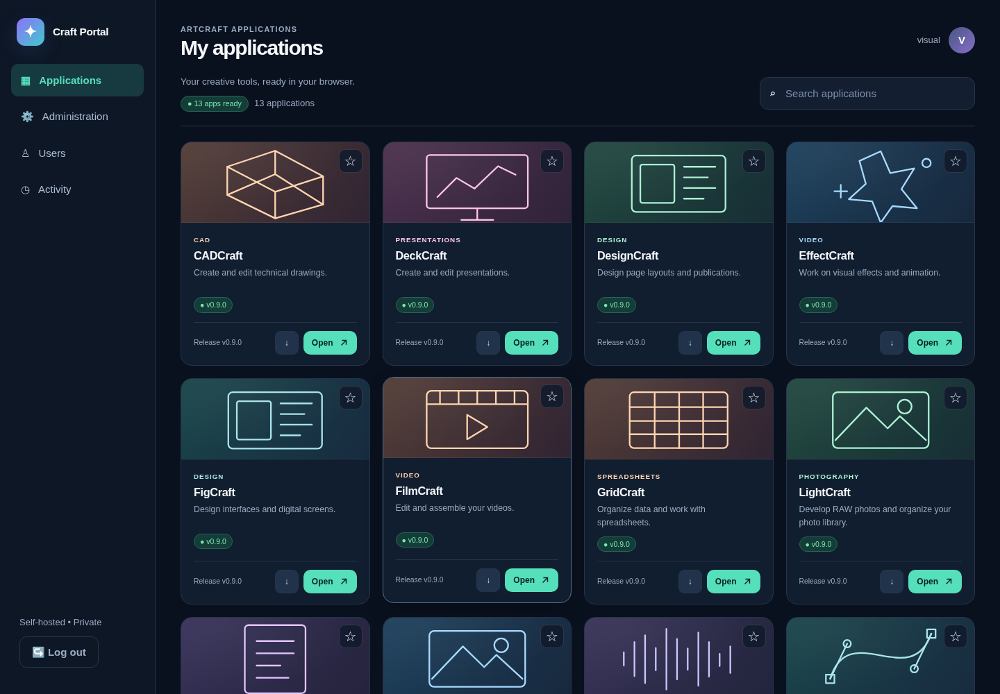
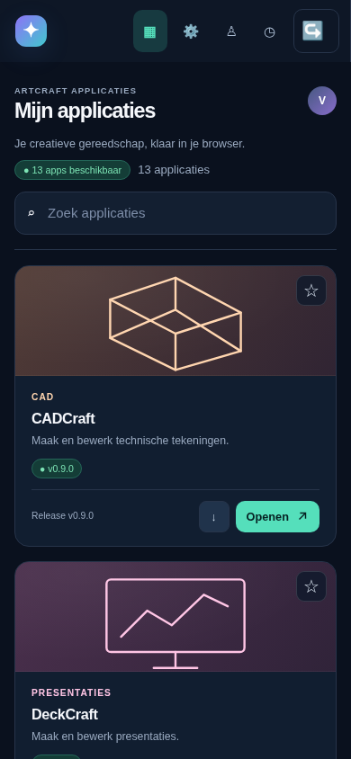

# Library layout, languages and console review — 2026-10-15

This change replaces the large introductory banner with a compact library toolbar
and gives application cards local category illustrations, stable colors and short
descriptions. Favorites, downloads and launch controls remain keyboard accessible.
All artwork is local SVG; there are no external image/font/translation requests.

## Visual check

Screenshots below come from the real local Chromium browser with synthetic data
for 13 apps, not the operator's live server. The live URL was blocked by the
managed cloud egress proxy (CONNECT403), so no production login was performed and
no supplied credentials were stored in code, fixtures, screenshots or logs.

| View | Before | After |
| --- | --- | --- |
| Desktop1440×1000, first app card top | 506px | 204px |
| Desktop introduction/banner height | 270px | 74px compact toolbar |
| Mobile390×844, first app card top | Not measured | 295px |
| Desktop/mobile horizontal overflow | — | None |
| Original local desktop console errors | 28 (CSP style attributes and favicon) | 0 |

The strict existing Content Security Policy is preserved. All inline style
attributes were replaced by stylesheet classes. A local SVG favicon eliminates
the missing-favicon request. Icons use SVG rather than font-dependent arrows.

## Languages

First supported browser language chooses Dutch (`nl-*`) or English (`en-*`). If
none matches, English is used; missing Dutch entries fall back to English.
Onboarding, authentication, library, administration, users, activity, dialogs,
known errors and app-session bridge use the same module. Dates/numbers/plurals
use the selected language. See [i18n.md](i18n.md) for development details. Upstream
app language and technical release diagnostics are not rewritten.

## Checks executed

- 65 non-browser tests passed, 14 opt-in browser cases skipped in the ordinary run.
- Explicit local browser/translation run: 8 passed (7 Chromium workflows +1
  translation-module test); 7 Firefox cases skipped because its binary is absent.
- Clean-console workflows for en-US, nl-NL and fr-FR exercised setup, login,
  applications, administration, users (single-user explanation), activity,
  downloads, versions and bridge recovery. No console errors, page exceptions,
  HTTP errors or failed requests. Separate intentional invalid-login tests
  expect their401 response and verify translated feedback.
- Existing authenticated WASM, rollback and same-profile OPFS isolation tests pass.
- Node syntax checks, hardened native Docker build/startup, nonroot i18n and
  bridge stylesheets, and backup-module import pass.

Strict hosted CI additionally installs Firefox and runs both engines. Release
publication is gated on those jobs and AMD64/ARM64 container builds. Genuine
upstream ArtCraft/WebGPU/service-worker acceptance remains a separate release
gate. This review does not claim those external app workflows or the live server
console were tested.
