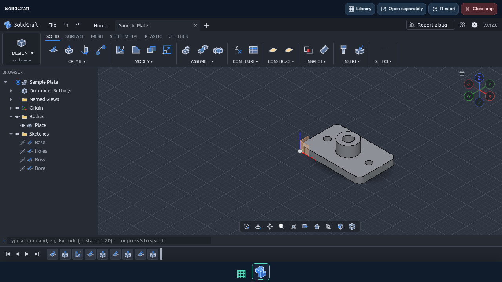

# SolidCraft

The portal includes [bherbruck/solidcraft](https://github.com/bherbruck/solidcraft)
as one explicitly selected additional publisher. Its static Rust/WASM web release
runs inside the existing app workspace, using the configured app origin and
normal per-account launch authorization. No extra server/container is needed.

## Install and update

Update the portal image and reload. With automatic discovery enabled (the default),
the startup updater discovers SolidCraft and installs its latest supported stable
release. Alternatively use Administration → Check now. If automatic discovery was
disabled, enable it for discovery. Existing per-app disable/update switches,
version retention and rollback work as for other apps. Normal GitHub API limits
and the optional GitHub token apply; no additional token is required.

Only the exact repository `bherbruck/solidcraft` is added to the trusted source
registry. It is not inferred from getartcraft.com's catalog and is checked even
when that catalog is unavailable. Original ArtCraft apps still require their
catalog publisher link. Releases must have a stable `vX.Y.Z` tag and an exact
`solidcraft-web-X.Y.Z.zip` asset with the publisher's SHA-256 and bounded size.
Checksums, traversal/link rejection, staging, atomic activation and retention are
unchanged. Other repositories by this publisher are not allowed.

SolidCraft has its own bundled icon and hero, with upstream MIT licensing and
source hashes beside the artwork. The library identifies the familiar Autodesk
Fusion workflow; searching Fusion finds SolidCraft. Cards, dock, favorites and
personal order work normally. Newly discovered apps append to a custom order.

## Storage and hosting

SolidCraft needs a secure browser context and WebGPU or WebGL2. Its native MCP
server and desktop-only features are not provided by the browser release. Save or
export project documents using the app's own controls. Server-volume backups do
not back up browser documents. Shared-host mode uses the browser-profile storage
boundary described in [workspace.md](workspace.md); isolated wildcard mode keeps
a distinct app/account origin.

The upstream web build registers an offline service worker that caches its app
code. For authenticated portal hosting, installation removes only the recognized
standalone registration script, after verifying/extracting the original ZIP and
before activating the staged version. An unrecognized registration block fails
before activation and retains the working release. Other bootstrap/module scripts
are preserved. SolidCraft service-worker requests are denied after authorization;
ordinary WASM workers remain supported. Offline app launching is intentionally
unavailable through the portal. Downloaded source archives are verified before
this documented HTML hosting adaptation.

## Acceptance evidence

Verified actual v0.12.0 archive: 15,909,200 bytes; SHA-256 matched the digest
published by GitHub:
`e7de4f5a276de48cba9a4b729f55bbd20affa128b4aec5f56a33f5f1be30e162`.
The real network download passed the portal's checksum, extraction, hosting
adaptation and atomic activation pipeline. Local HTTPS Chromium opened the app
embedded and separately; a sample parametric plate with holes and a feature
history rendered. The adapted build produced no JS exceptions, console errors,
failed requests or HTTP errors. Headless rendering used the software GPU fallback.
This verifies startup/sample loading, not every CAD operation or export format.

